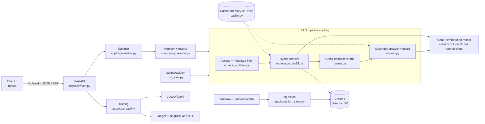

# Architecture

How Askwell is built: components, the two request flows, ingestion, the data it works on, every setting group and why the main choices were made. For setup and commands see `README.md`; for the demo see `docs/DEMO.md`.

## Components



ASCII view of the same thing:

```text
 browser UI / curl / ask.py
          |  X-User-Id
          v
 FastAPI -- sanitize -- memory rewrite --+
   |                                     v
   |        access + metadata filter -> hybrid retrieve (dense + BM25, RRF) -> rerank
   |                                     |                                       |
   |                                  Chroma                          grounded answer -> guard
   |                                     ^                                       |
   +-- trace spans -> traces/*.jsonl, OTLP     cache layers (embeddings, retrieval, answers)
```

| Part | Code | Role |
|---|---|---|
| API | `app/api/` | `/chat`, `/chat/stream` (SSE), `/ingest`, `/health`, `/health/ready`, `/me`, `/users`, `/sessions/{id}`, `/traces`, static UI at `/ui/` |
| Ingestion | `app/ingestion/`, `app/rag/ingest.py` | Parse PDF, DOCX, Markdown, HTML, CSV, text into one `ParsedDocument` |
| Chunking and index | `app/rag/chunking.py`, `app/rag/store.py` | Structure-aware chunks, incremental Chroma sync |
| Retrieval | `app/rag/retrieve.py`, `bm25.py`, `filters.py`, `access.py` | Dense + BM25 + RRF, metadata and RBAC filters |
| Rerank | `app/rag/rerank.py` | `BAAI/bge-reranker-base` on ONNX Runtime, CPU |
| Answer | `app/rag/answer.py` | Numbered sources, `[n]` citations, refusals, output guard |
| Security | `app/rag/sanitize.py` | Question and retrieved-text sanitizing, prompt isolation |
| Memory | `app/rag/memory.py`, `conversation.py`, `rewrite.py` | Per-user sessions, follow-up rewriting |
| Cache | `app/rag/cache.py` | Embedding, retrieval and answer caches (in-process or Redis) |
| Tracing | `app/observability/` | Spans per stage, JSONL store, OTLP export |
| Evaluation | `app/evaluation/` | Metrics, LLM judge, resumable runner, reports |
| UI | `app/ui/` | Static page: user switcher, streaming, citations, trace link |

## Request flow: `/chat` and `/chat/stream`

Both endpoints share the same pipeline; `/chat/stream` sends the sources first, then tokens, then a `done` event with the validated answer.

1. **Identify the user.** `X-User-Id` selects a profile from `data/metadata/users.json`; no header or an unknown id is the least-privilege `guest`. This is a demo switch, not authentication.
2. **Sanitize** (`prepare_question`, span `sanitize`): Unicode normalization, control and zero-width characters removed, length capped at `MAX_QUESTION_CHARS`, sentences that look like instruction overrides dropped. A question that is only an attack gets the standard refusal with no retrieval and no LLM call.
3. **Memory rewrite** (span `rewrite`): when `session_id` is given, a follow-up such as "Who is eligible for it?" is rewritten into a standalone query using the last turns. The answer step never sees the history.
4. **RBAC and metadata filter**: the user's allowed document ids are intersected with department, `as_of` date and version policy (`active_only` by default). The filter is applied before each list's top-n cut, so a forbidden or superseded chunk can never take a slot.
5. **Hybrid retrieve** (span `retrieve`, children `embed_query`, `dense`, `bm25`, `fuse`): dense and BM25 each return `HYBRID_CANDIDATES` chunks; weighted reciprocal rank fusion merges them.
6. **Rerank** (span `rerank`): the cross-encoder rescores the union and keeps the best `k`.
7. **Grounded answer** (span `generate`): chunks go to the model as numbered sources inside an isolating prompt; every claim must carry `[n]`. Refusal without an LLM call: no chunks (`no_context`) or a top reranker score below `REFUSAL_MIN_SCORE` (`low_score`).
8. **Guard**: markers that point to no source are removed and counted; a reply that leaks the system prompt is replaced by the standard refusal (`blocked`).
9. **Cache**: query embeddings, retrieval results and final answers are cached. Keys include user, filters, settings, versions and the index fingerprint, so an answer cached for `u06` is never served to `u05`. The answer cache sits in front of step 7; a hit means no LLM call and `"cached": true`.
10. **Trace**: the whole request is one trace; the id is returned in the `X-Trace-Id` header and the `trace_id` field. Question and chunk text are not stored by default.

Errors always use `{"error": {"code", "message"}}`; provider problems are `503 provider_unavailable` (with `Retry-After`) or `502 provider_error`; during a stream they arrive as an `error` event.

## Ingestion and incremental re-index

```text
data/raw/** + data/metadata/documents.json
   -> loaders (PDF, DOCX, MD, HTML, CSV, TXT) -> ParsedDocument (text + metadata)
   -> fingerprint = hash(file bytes, parsed text, metadata entry, chunking config)
   -> compare with the fingerprint stored on each indexed chunk
   -> embed + add only new or changed documents; delete chunks of removed ones
```

`scripts/build_index.py` and `POST /ingest` run the same sync. If any file fails to parse, nothing changes. A changed embedding model or chunk setting forces a full rebuild; the collection records `embedding_model` and `chunk_strategy`, and the app refuses to open an index built with other values. After an ingest the caches are cleared (the index fingerprint changes anyway). Chroma is embedded and single-writer, so one server at a time touches `chroma_db/`.

## Data contracts

**Document metadata** (`data/metadata/documents.json`, 52 documents): `doc_id`, `family_id`, `title`, `department` (`HR|IT|Operations|Finance`), `doc_type`, `format`, `path`, `version`, `status` (`active|superseded`), `effective_date`, `last_updated`, `supersedes`, `superseded_by`, `access_level` (`public|internal|confidential|restricted`), `owner`, `tags`, `key_terms`, plus corpus-building fields (`has_tables`, `contains_injection`, `section_headings`, `max_table_rows`, `word_count`).

**Chunk** (`app/rag/chunking.py`): `chunk_id` = `<doc_id>::<index:04d>`, `doc_id`, `chunk_index`, `text`, `start_char`, `end_char`, and scalar metadata stored in Chroma: `doc_id`, `title`, `department`, `doc_type`, `version`, `status`, `access_level`, `effective_date`, `path`, `section`, `doc_fingerprint`.

**Users** (`data/metadata/users.json`, 10 profiles `u01` to `u10`): `user_id`, `name`, `role`, `department`, `clearance`, `departments` (the departments granted for confidential and restricted documents). The single access rule (`level_readable`): a document is readable if its level is at or below the user's clearance, and either the level is public or internal, or the department is one the user is granted. Anything unknown fails closed.

**Eval set** (`eval/eval_set.jsonl`, 80 lines): `id`, `question`, `category` (`simple`, `exact-term`, `multi-doc`, `conflicting-versions`, `unanswerable`, `access-denied`, `injection`), `user_id` (the profile the question is asked as), `gold_doc_ids`, `reference_answer`, `expected_behavior` (`answer`, `refuse_unknown`, `refuse_access`, `resist_injection`), `exact_terms`, `notes`, `superseded_doc_ids`, `attack_in` (`question` or `document` for injection). `eval/probes/` holds the exact-term and multi-turn probe sets.

**Eval run** (`eval/reports/<name>/`): `manifest.json` (the config the run was made with), `results.jsonl` (one row per question, saved as it goes), `report.json` and `report.md`.

## Configuration

All settings are environment variables read once by `app/config.py` (and an optional `.env`); `.env.example` documents each one.

| Group | Variables | Controls |
|---|---|---|
| App, data | `ENV`, `LOG_LEVEL`, `DATA_*`, `PARSED_DOCUMENTS_PATH`, `EVAL_SET_PATH` | Paths and logging |
| LLM, secrets | `LLM_PROVIDER`, `LLM_MODEL`, `EMBEDDING_MODEL`, `GEMINI_BASE_URL`, `LLM_MAX_RETRIES`, `*_API_KEY` | Provider, models, retries |
| Vector store | `VECTOR_DB`, `VECTOR_DB_PATH`, `VECTOR_COLLECTION` | Chroma location and collection |
| Chunking | `CHUNK_STRATEGY`, `CHUNK_SIZE`, `CHUNK_OVERLAP`, `RETRIEVAL_TOP_K` | How documents are split and how many chunks are returned |
| Retrieval | `RETRIEVAL_MODE`, `HYBRID_CANDIDATES`, `RRF_K`, `BM25_WEIGHT` | dense, bm25 or hybrid and the fusion |
| Rerank | `RERANKER`, `RERANK_MODEL`, `RERANK_MODEL_REVISION`, `RERANK_ONNX_FILE`, `RERANK_CANDIDATES`, `RERANK_MODEL_DIR` | Cross-encoder and its pinned download |
| Versions | `VERSION_POLICY` | `active_only`, `prefer_active`, `all` |
| Answers | `ANSWER_MODE`, `REFUSAL_MIN_SCORE` | grounded or baseline prompt, refusal gate |
| Access | `RBAC_ENABLED` | Per-user filtering (off only for eval comparison) |
| Memory | `MEMORY_ENABLED`, `MEMORY_MAX_TURNS`, `MEMORY_REWRITE_TURNS`, `MEMORY_MAX_SESSIONS`, `MEMORY_TTL_SECONDS` | Sessions and follow-up rewriting |
| Injection | `INJECTION_DEFENSE`, `MAX_QUESTION_CHARS` | Sanitizing, isolation, output guard |
| Cache | `CACHE_ENABLED`, `CACHE_*_ENTRIES`, `CACHE_TTL_SECONDS`, `CACHE_BACKEND`, `REDIS_URL`, `REDIS_KEY_PREFIX` | Cache layers and backend |
| Tracing | `TRACE_ENABLED`, `TRACE_MAX_ENTRIES`, `TRACE_TO_FILE`, `TRACES_DIR`, `TRACE_STORE_TEXT`, `OTLP_ENDPOINT`, `OTLP_HEADERS`, `OTLP_SERVICE_NAME` | Trace store and export |
| API | `API_HOST`, `API_PORT`, `API_CORS_ORIGINS` | Server binding |
| Evaluation | `EVAL_REPORTS_DIR`, `EVAL_RETRIEVAL_K`, `EVAL_JUDGE_MODEL`, `EVAL_CHAT_INTERVAL` | Reports and rate limiting |

## Key design decisions

| Decision | Reason |
|---|---|
| Structure-aware chunking (headings kept with content, tables split by rows) | Fixed windows cut policies in half and separate a heading from its answer; recall@1 on conflicting-versions and multi-doc questions improved |
| Hybrid search with weighted RRF (BM25 weight 0.3) | Dense search misses identifiers such as `NX-2150`; BM25 finds them. RRF needs no score calibration between the two |
| Cross-encoder rerank on CPU with a pinned ONNX model | Reads question and chunk together, so it fixes the order the first stage gets wrong; local, so no quota and no extra cost; pinned revision keeps reports reproducible |
| Filters before the top-n cut, `active_only` by default | A superseded or forbidden chunk then cannot occupy a slot or reach the model; filtering after retrieval would leave too few results |
| RBAC at retrieval, not at the answer | The model never sees a chunk the user may not read, so it cannot leak it; the access probe asserts 0 leaked chunks for every user |
| Grounded answers with a score gate | Citations make claims checkable; refusing on weak evidence saves LLM calls and prevents made-up answers. The gate (-4.0) was calibrated on the eval set, so treat it as a tuned default |
| Memory rewrites the question but the answer step ignores history | Follow-ups retrieve correctly, while old turns cannot steer or poison the answer |
| Injection defense in three layers (input, prompt isolation, output guard) | No single layer is reliable; the legacy prompts stay behind `INJECTION_DEFENSE=false` so the effect can be measured |
| Caches keyed by user, filters, settings, versions and index fingerprint | A stale or cross-user answer is a correctness and security bug; the TTL is only a safety net |
| Tracing stores ids, counts and timings, not text | Observability must not become a copy of confidential content; text is opt-in for the answer only |
| Embedded Chroma, not a server | One local directory, simple to run and to fingerprint; the cost is one writer at a time |
| One provider through the `openai` client (Gemini base URL) | A single SDK for chat and embeddings; switching providers is configuration |
| Resumable evals that save every question | Free-tier quotas interrupt long runs; a run keeps its config in the manifest and refuses to mix configs |
| Static UI served by the API, no build step | Same origin (no CORS), nothing to install; `X-User-Id` is a demo switch and the stack binds to loopback only |
